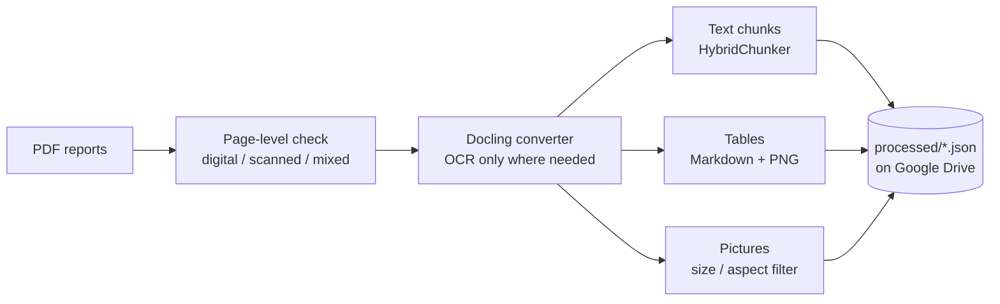

# 01 · Ingestion with Docling

**Notebook:** [`01_ingestion_docling.ipynb`](01_ingestion_docling.ipynb) · **Runtime:** Google Colab, T4 GPU

Turns raw annual-report PDFs into structured, searchable pieces: **text chunks, tables and charts**, each tagged with company, fiscal year and page number, so every later answer can be cited back to its source page.

## Input → output

| | |
|---|---|
| **Input** | Annual report PDFs in Google Drive, organized as `reports/<company>/<year>.pdf` (digital, scanned or mixed) |
| **Output** | One JSON file per report in `processed/`, holding every text chunk, table and chart with its metadata, plus a PNG for every table and chart in `images/` |

Each element looks like this:

```json
{
  "id": "<company>_<year>_table_52",
  "type": "table",
  "company": "<company>",
  "year": "2024",
  "page": 148,
  "content": "| Particulars | ... |   (Markdown table)",
  "image_path": "images/<company>_<year>_table_52.png",
  "parse_mode": "digital"
}
```

## Pipeline



1. **Metadata and classification:** every page is checked for extractable text. Under 10% empty pages = *digital*, over 80% = *scanned*, otherwise *mixed*.
2. **Converter per mode:** digital PDFs skip OCR and use `do_cell_matching`, so table numbers come from the PDF's real text rather than a model's guess. Scanned pages use EasyOCR on the full page; mixed pages OCR only the image regions.
3. **Structure-aware chunking:** Docling's `HybridChunker` splits at section boundaries, keeps chunks under bge-small's 512-token limit, and prepends the section heading so a chunk like "it rose 12%" still makes sense on its own.
4. **Tables:** kept twice, as Markdown (for the LLM and search) and as an image (for the app and visual retrieval).
5. **Charts:** detected on the rendered page, so vector-drawn charts that plain image extraction misses are captured. Logos, icons and banners are dropped by size and aspect ratio.
6. **Batch processing:** each report is converted in 40-page slices, each saved to Drive as soon as it finishes.

## Design decisions

| Decision | Why |
|---|---|
| Docling | Open source, strong table-structure model (TableFormer), page-rendered picture detection, no page limits |
| OCR off for digital PDFs | Faster and exact: OCR can misread `8` as `B` or `1,234` as `1.234` |
| OCR routing per report (digital / scanned / mixed) | Scanned and mixed reports still work, and every element records its `parse_mode` so OCR'd numbers can be treated with caution later |
| 40-page batches with per-batch checkpoints | Full reports exhausted Colab's ~13 GB RAM; batching keeps usage flat (8-10 GB) and lets a run resume mid-report |
| Page offset added after batching | Docling numbers each batch from page 1; the offset keeps citations pointing at the real page |
| Fiscal year = the year it ends | "FY 2022-23" is stored as `2023`, matching how analysts write FY23 |

## Scaling

- **Incremental:** finished reports and finished batches are skipped on rerun, so adding a report only processes that report
- **Resumable:** a Colab disconnect loses at most one 40-page batch
- **Throughput:** about 6 minutes per 180-page digital report on a free T4; scanned reports are slower because of OCR

## Issues found and fixed

- **Out-of-memory crash** on full reports → 40-page batching with checkpointing
- **Messy IDs** from folder names with spaces and 2-digit years → one-time migration to clean `<company>_<yyyy>` IDs, no reprocessing
- **Dropped table cells:** Docling can warn that some PDF text cells don't fit the table grid; tables are spot-checked against their page images
- **₹ symbol stored as "H" or "C"** by custom PDF fonts (`(H in Crore)`) → fixed at load time in Notebook 2

## Next

[`02_rag_pipeline`](02_rag_pipeline.ipynb) filters images down to real charts with CLIP, summarizes tables and charts with Gemini, and builds the search index.
