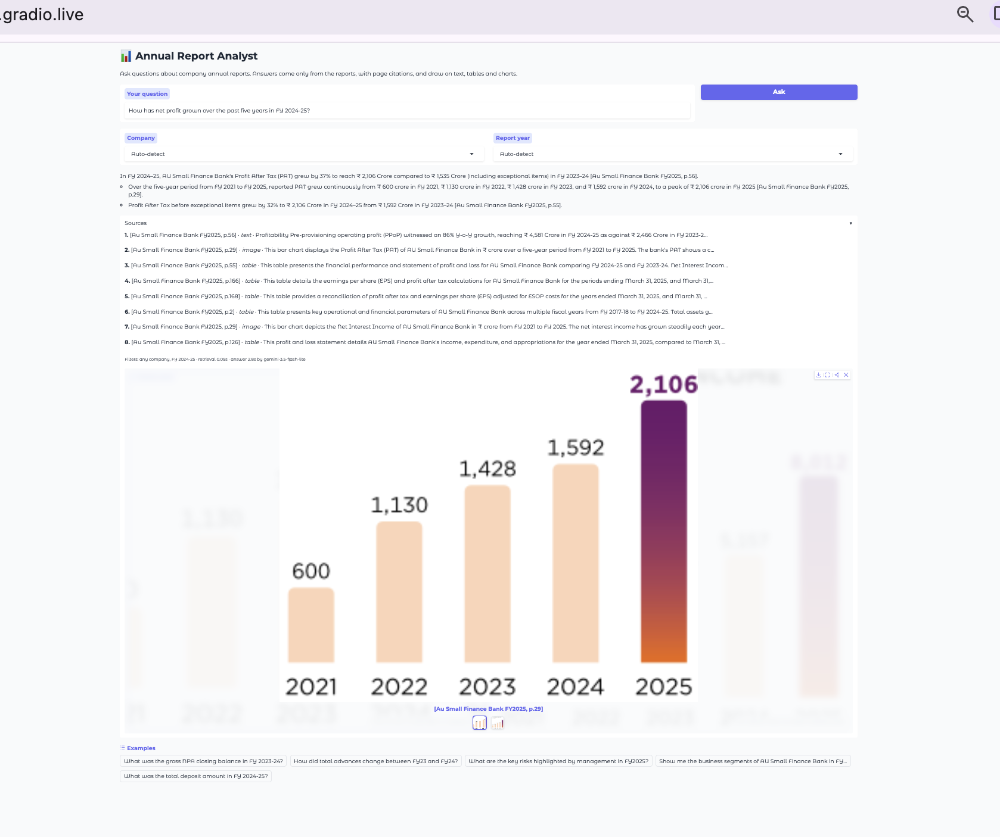

# 06 · App: Gradio

- **Files:** app.py, requirements.txt,  06_app_and_deploy.ipynb (packages the data and launches the app) 
- **Runtime:** Google Colab 
- **Needs:** `GEMINI_API_KEY` in Colab Secrets

A web app over the final system. Type a question and get a grounded answer with page citations, the list of sources used, and the charts that informed the answer.

## What the app uses

The best setup from the evaluation that also runs fast on a free CPU:

| Component | Choice | Why |
|---|---|---|
| Search | Fine-tuned bge-small + BM25, fused with RRF | Judged Hit@5 0.98, millisecond latency on CPU |
| Filters | Company and fiscal year parsed from the question, with dropdown overrides | Prevents cross-year mix-ups |
| Answering | Gemini with chart images in the context and the anti-hallucination prompt | Grounded, cited, refuses when the answer isn't there |
| Reranker | Not used | ~35 s per query on CPU for no gain under judged scoring |

Search uses plain numpy over the exported embeddings rather than ChromaDB, so the app loads quickly and needs no database.

## Example results

| Question | Sources used | Outcome | Time |
|---|---|---|---|
| Gross NPA closing balance in FY 2023-24 | Table | Exact total plus the sub-standard / doubtful / loss breakdown, cited to the page | 0.14 s search · 1.1 s answer |
| How has net profit grown over the past five years? | Bar chart + tables | All five yearly figures read from the chart, plus year-on-year growth on the correct base | 0.09 s search · 2.8 s answer |
| Who is the CEO of Google? | n/a | Refused: not in the reports | n/a |

## Reliability

- **45-second timeout** per Gemini call, moving straight to the next model on any timeout, overload or quota error
- **Model order:** 3.5 Flash-Lite first (fastest, and the same model the 84% answer accuracy was measured with), then 3.8 → 3.7 → 3.6 Flash as fallbacks
- **Status logging:** each attempt prints its model, result and timing
- **Friendly failure:** if every model is busy, the app says so instead of crashing

## Running the app

The notebook:
1. Exports the fine-tuned embeddings, a slimmed docstore and the chart images into `data/`, and copies the fine-tuned model into `model/`
2. Writes `app.py` and `requirements.txt`
3. Tests one question, then launches the app with a temporary public link (`share=True`)

The link stays live while the launch cell is running.

**Permanent hosting (optional):** `app.py` and `requirements.txt` are ready to run as a Hugging Face Space (store `GEMINI_API_KEY` as a Space secret). New free Hugging Face accounts can no longer create CPU Spaces, so this project is demoed from Colab instead.

## Typical response time

| Step | Time |
|---|---|
| Search (CPU) | under 0.5 s |
| Gemini answer | 1-10 s, longer with charts attached |

**Libraries:** `gradio`, `sentence-transformers`, `rank_bm25`, `google-genai`, `numpy`
